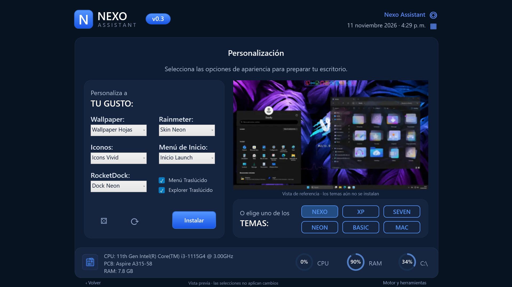

# Nexo Assistant 0.3

Asistente de evaluación para Windows con 14 pantallas, selección de preferencias y un motor de acciones revisables. La interfaz sigue la distribución visual de DELTA v13; el proyecto es independiente.



## Ejecutar desde este repositorio

En Windows x64, abre PowerShell en la carpeta del repositorio y ejecuta:

```powershell
powershell.exe -NoProfile -ExecutionPolicy Bypass -File .\Build.ps1
.\NexoAssistant.exe
```

El lanzador se compila con .NET Framework de Windows. La interfaz utiliza Windows PowerShell 5.1 y WPF; no necesita Python ni Node. El ejecutable compilado se genera localmente y no se versiona.

Recorrer las pantallas guarda preferencias. Las acciones disponibles se envían al motor para una revisión y confirmación separadas antes de modificar Windows. Office, migración, compresión, temas completos y ajustes especializados siguen pendientes y se señalan en el resumen.

## Documentación

- [Instrucciones, funciones disponibles y limitaciones](LEEME.md).
- [Guía visual y comparador con la referencia](guia/Guia-del-cliente.html): abre el archivo descargado en un navegador.
- [Procedencia de las imágenes de referencia](REFERENCIAS.md).
- [Resultados de validación](validacion.json): 71 comprobaciones superadas en la entrega del 11 de noviembre de 2026. Las instalaciones reales en máquinas de prueba siguen pendientes.

Los gráficos de referencia pertenecen a sus respectivos autores. Consulta su procedencia antes de reutilizarlos o distribuirlos.

## Código

`Nexo.ps1`, `Window.xaml` y `WizardCatalog.json` implementan el recorrido. `Engine.ps1`, `Engine.xaml`, `Core.psm1` y `Worker.ps1` revisan y ejecutan las acciones disponibles. Las pruebas del motor están en `tests/Test-Core.ps1`.

Este repositorio contiene Nexo Assistant 0.3 y su guía. La ISO Nexo OS es un artefacto separado.
